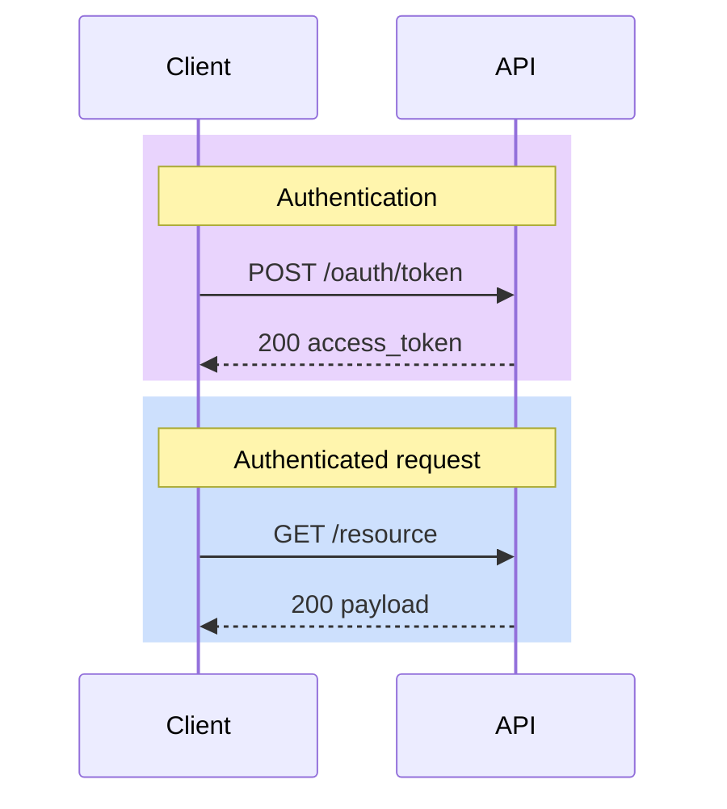

# Authoring Recipes

## Contents

- GitHub inline example
- Sequence diagrams: rect rgba highlights
- Flowcharts: classDef plus the palette
- Edge styles

## GitHub inline example



The semi-transparent rects blend with both light and dark backgrounds, and GitHub's mermaid renderer auto-adapts text colors for readability.

## Sequence diagrams — use `rect rgba(...)` for mode-agnostic highlight

Wrap token-acquisition, error paths, and multi-step sections in `rect` blocks.
Use the rgba column of the palette table in SKILL.md — these read on both light and dark backgrounds
because semi-transparent fills blend with the host background.

```
sequenceDiagram
    participant Client
    participant API

    rect rgba(168, 85, 247, 0.25)
        Note over Client,API: Step 1 — Acquire token (state)
        Client->>API: POST /oauth/token
        API-->>Client: JWT
    end

    rect rgba(59, 130, 246, 0.25)
        Note over Client,API: Step 2-N — Authenticated calls (service)
        Client->>API: GET /resource  [Bearer JWT]
    end
```

**Do NOT** embed `%%{init}%%` with hardcoded actor/text colors in diagrams
intended for GitHub markdown rendering — that forces one theme and breaks
user dark-mode adaptation. Set theme only when rendering to static SVG with
a known target (see Rendering in SKILL.md).

## Flowcharts — use `classDef` + the palette

```
flowchart LR
  classDef service fill:#4285F4,stroke:#1a73e8,color:#fff
  classDef state fill:#A142F4,stroke:#8430ce,color:#fff
  classDef errBlock fill:#EA4335,stroke:#c5221f,color:#fff

  API["API Gateway"]:::service
  Cache["Token Cache"]:::state
  Err["403 Blocked"]:::errBlock

  API --> Cache
  API -.-> Err
```

Always include a **Legend subgraph** when a diagram uses more than 5 node
classes — see [example-conventions.mmd](example-conventions.mmd).

## Edge styles

| Style | Syntax | Meaning |
|-------|--------|---------|
| Solid + filled arrow | `A --> B` | Synchronous call |
| Solid + label | `A -->\|"POST /foo"\| B` | HTTP or labeled sync call |
| Dashed + filled arrow | `A -.-> B` | Async, streaming, exceptional path |
| Dotted + open arrow | `A -.-\|"side-effect"\| B` | Dependency, audit, optional |
