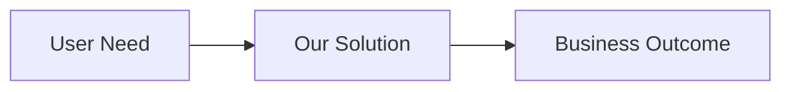
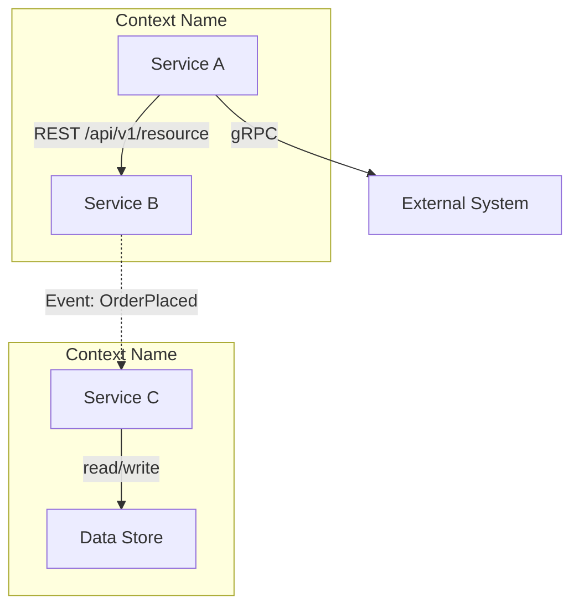
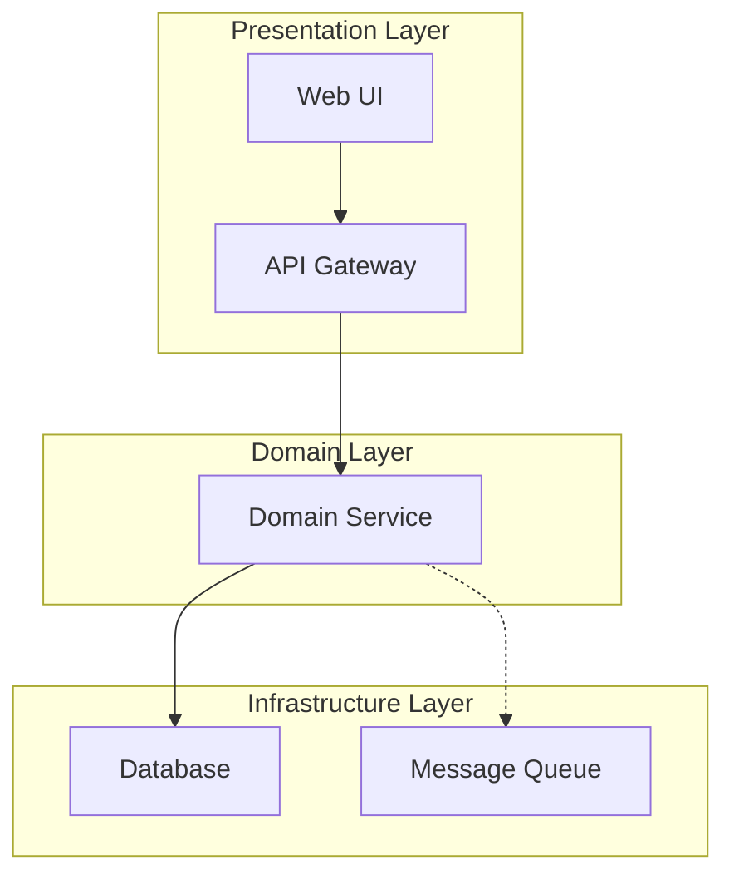
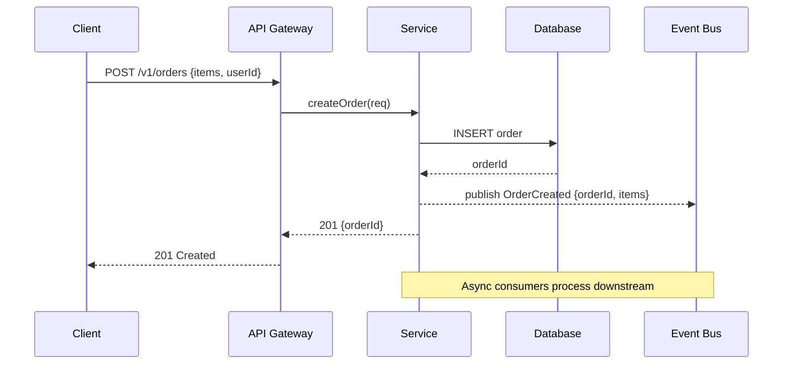
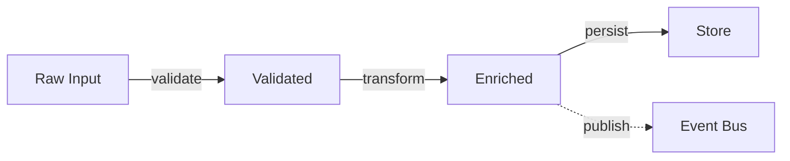
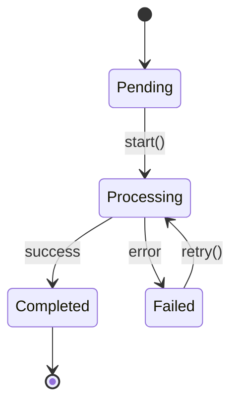

# Diagram Patterns

## Contents

- [Style Reference](#style-reference)
- [Exec Diagrams](#exec-diagrams)
- [Architect Diagrams](#architect-diagrams)
- [Engineer Diagrams](#engineer-diagrams)
- [Diagram Selection Heuristic](#diagram-selection-heuristic)

---

Mermaid diagram patterns for each audience mode. Render with the `diagram` skill:
```bash
R=~/.skills/diagram/scripts/render.mjs
node $R <file>.mmd --for confluence --theme light --out <file>.svg          # standalone
node $R <file>.mmd --theme light --format png --zoom 3 --out <file>.png     # for PPTX embedding
```

## Style Reference

Reuse the `classDef` palette from the `diagram` skill's Semantic colors table
(`~/.skills/diagram/SKILL.md`). Each fill is the hue at 25% alpha, with no `color:`,
so node text uses the theme's text color:

```mermaid
classDef person fill:#78716C40,stroke:#78716C,stroke-width:1.5px
classDef service fill:#3B82F640,stroke:#3B82F6,stroke-width:1.5px
classDef library fill:#0284C740,stroke:#0284C7,stroke-width:1.5px
classDef guard fill:#CA6A0440,stroke:#CA6A04,stroke-width:1.5px
classDef external fill:#64748B40,stroke:#64748B,stroke-width:1.5px
classDef state fill:#A855F740,stroke:#A855F7,stroke-width:1.5px
classDef errBlock fill:#EF444440,stroke:#EF4444,stroke-width:1.5px
classDef passNode fill:#15913F40,stroke:#15913F,stroke-width:1.5px
```

**Edge conventions:**
- Solid arrow (`-->`) = synchronous call
- Dashed arrow (`-.->`) = async / streaming / error path
- Label edges with operation name and key payload

**Legend:** Include a `subgraph Legend` for diagrams with more than 5 nodes.

## Exec Diagrams

Rarely used. Only when explicitly requested. Keep to 3-5 nodes.



- No technical labels. Use business language on nodes and edges.
- No subgraphs or nested structure.
- Value or impact labels on edges ("saves $X/yr", "reduces time by Y%").

## Architect Diagrams

Default diagram type: **component diagram** (`flowchart TB`).

**Component diagram pattern:**


**Always show:** system boundaries (subgraphs), external systems, data stores,
sync vs async edges, protocol labels.

**Layered view pattern** (for showing architectural layers):


**Current vs target state:** Use two separate diagrams side by side, labeled
"Current State" and "Target State". Highlight changes with color or annotations.

## Engineer Diagrams

Default diagram type: **sequence diagram**.

**Sequence diagram pattern:**


**Always show:** error paths (alt/opt blocks), async operations, concrete
endpoint names, payload shapes.

**Data flow pattern** (`flowchart LR`):


**State machine pattern** (`stateDiagram-v2`):


## Diagram Selection Heuristic

| Source content describes... | Exec | Architect | Engineer |
|----------------------------|-------|-----------|----------|
| System components and interactions | skip | Component diagram | Sequence diagram |
| Data pipeline or transformations | skip | Component diagram | Data flow diagram |
| Stateful process or lifecycle | skip | Component diagram | State machine |
| Migration or evolution | skip | Current vs target | Sequence + data flow |
| Simple business flow | Flowchart (if requested) | Component diagram | Sequence diagram |
